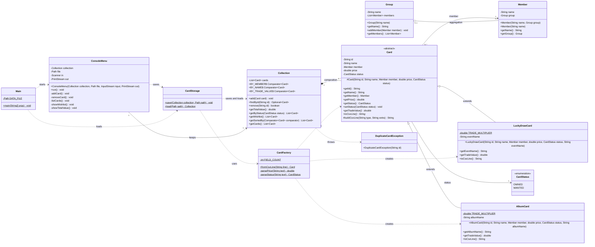

# Design: Photocard Collection Manager

## Problem statement

**Users:** K-pop fans who collect photocards.
**Goal:** keep track of the cards they own and the ones they still want, see what each card is worth for trading, and keep that record between sessions.
**Problem:** a loose list in a notes app does not tell you the trade value, cannot be sorted, lets you add the same card twice, and is easy to lose. This console app keeps one clean list, rejects bad input, and saves it to a file after every change.

## Packages

| Package | Holds | Why |
|---|---|---|
| `com.photocard.domain` | `Card`, `AlbumCard`, `LuckyDrawCard`, `CardStatus`, `Member`, `Group`, `DuplicateCardException` | The things in the problem. |
| `com.photocard.service` | `Collection`, `CardFactory` | The rules that work on the things. |
| `com.photocard.persistence` | `CardStorage` | Saving and loading. |
| `com.photocard.ui` | `ConsoleMenu` | What the user sees and types. |
| `com.photocard` | `Main` | Starts the program. |

## UML class diagram

`+` public, `-` private, `#` protected, `$` static, `*` abstract. Multiplicities are written on the lines between classes.

### How to read the relationships

| Relationship | Multiplicity | Meaning |
|---|---|---|
| `Collection` composes `Card` | 1 to 0..* | A collection owns its cards; a card does not live outside a collection. |
| `Card` to `Member` (association) | many to 1 | Every card has exactly one member; a member can have many cards. |
| `Group` aggregates `Member` | 0..1 to 0..* | A group has many members; a member has at most one group (none for a solo artist). A member can exist without a group. |
| `AlbumCard`, `LuckyDrawCard` extend `Card` | | Inheritance: both are cards with their own trade value and CSV line. |
| `CardFactory` creates `AlbumCard` / `LuckyDrawCard` | | Dependency: it builds them and returns them as `Card`. |
| `ConsoleMenu` keeps a `Collection` | 1 to 1 | The menu holds the collection it was given. |

## Design pattern: Factory

**Problem it solves.** A saved file mixes card types (`ALBUM` and `LUCKY` lines). The code that reads the file should not need to know every card class.

**Participating classes.**
- `CardFactory` is the factory. Its method `fromCsvLine(String)` reads the type in a saved line and builds the right object.
- `Card` is the common type the factory returns.
- `AlbumCard` and `LuckyDrawCard` are the concrete products.
- `CardStorage.load` is the client: it hands each line to the factory and adds the result to a `Collection`.

**Benefit.** To add a new card type (for example `POBCard`) you add the class and one `case` in `CardFactory`. `CardStorage`, `Collection` and the menu do not change. A bad line (unknown type, wrong number of fields, price not a number) is turned into a clear error in one place.

**Where in the source.** `src/main/java/com/photocard/service/CardFactory.java`, called from `src/main/java/com/photocard/persistence/CardStorage.java`.

## Requirements and where they are met

| Requirement | Where |
|---|---|
| Encapsulation | Private fields in `Card`, `Member`, `Group`, `Collection`, `ConsoleMenu`; constructors reject blank names and negative prices; lists are returned read-only or as copies. |
| Abstraction | Abstract class `Card`. |
| Inheritance and polymorphism | `AlbumCard` (x1.0) and `LuckyDrawCard` (x1.5) override `getTradeValue()` and `toCsvLine()`; `Collection.getTotalValue()` and `CardStorage.save` call them on `Card` references, so the version of the real object runs. |
| Relationships with multiplicities | Composition, association, aggregation (see the diagram). |
| Generics and sorting | `List<Card>`, `Optional<Card>`, three `Comparator<Card>` constants used by `getSortedBy`. |
| Validation and a custom exception | Constructors and menu input checks; checked `DuplicateCardException`. |
| Persistence with try-with-resources | `CardStorage.save` and `load` (CSV). |
| Tests | 21 JUnit tests, run with `./mvnw clean test`. |

## Design decisions

1. **Validation lives in the constructors.** An invalid `Card`, `Member` or `Group` can never exist, and the check is written once (subclasses call `super(...)`).
2. **A member's group is fixed at creation.** `Group.addMember` only accepts members created for that group, so the group and the member can never disagree.
3. **`toCsvLine()` lives on the cards.** The format sits next to the data, `CardStorage` does not need to know the card types, and the shared part is written once in `Card.buildCsvLine`.
4. **One exception type for a bad file.** `CardStorage.load` turns a bad line or a repeated id into an `IOException` with "Line n: ...", so the program handles every load failure in one place.
5. **A broken file stops the app at start.** Starting with an empty collection would let the next save overwrite the broken file and lose the data.
6. **The menu holds no rules.** It reads input and calls `Collection` and the `Card` constructors, so the same rules apply to the menu, the factory and the tests. It takes an `InputStream` and a `PrintStream` in its constructor so tests can feed it text.
7. **Sorting works on a copy.** `getSortedBy` never changes the collection's own order.
8. **Class name.** The binder is named `Collection` and imports only specific `java.util` classes so it does not clash with `java.util.Collection`.

## Known limitations

- A `Member` must be created with its group first, then added with `Group.addMember`.
- The CSV format has no escaping, so names cannot contain commas (the menu rejects them).
- Every loaded line creates its own `Group` object, so two members of the same group do not share one `Group`, and `Group.getMembers()` is not filled when loading.
- The save file is rewritten in full on every save.
- Loading stops at the first bad line instead of skipping and reporting it.
- The menu can add and remove cards but cannot change a card's status (`Card.setStatus` exists but is not used by the menu).
- Console only: no GUI.
